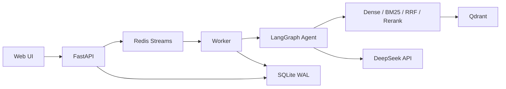
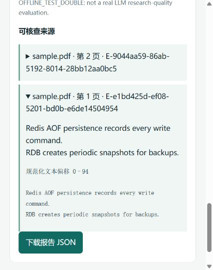

# KnowledgeOps

基于混合检索与 LangGraph 的技术文档问答系统。

导入 PDF、Markdown、TXT 或网页后，可以直接检索原文，也可以让 Agent 检索、对比证据并生成报告。回答中的引用可以展开查看原文、页码和章节；任务页面记录工具调用、耗时和 Token 预算。

Python 3.11+ · FastAPI · PyTorch · Qdrant · BM25 · LangGraph · DeepSeek · Redis

## 主要实现

- **文档索引**：提取文本、按页与段落分块，保留来源及位置。以内容哈希去重，失败的导入不会进入检索结果。
- **检索与重排**：BGE-M3 生成 dense 向量，Qdrant 提供向量检索；BM25 负责关键词召回，RRF 合并两路排名，bge-reranker-v2-m3 对候选分块重排。各阶段分数分别保存。
- **研究流程**：DeepSeek Flash 通过 LangGraph 调用 `knowledge_search`、`compare_evidence`、`build_report`，支持多轮追问。引用 ID 由服务端生成，提交报告时核对证据范围与原文摘录。
- **执行控制**：工具白名单、超时、有限重试、调用与 Token 预算。SQLite 保存任务、事件和检查点，Redis Streams 投递任务，Worker 重启后按租约恢复。



离线模式将 API 与 Worker 放在同一进程，使用 Qdrant Local 和确定性模型替身，方便无密钥体验与回归测试。真实模型配置见[部署文档](docs/running.md)。

## 快速运行

安装 Python 3.11 或 3.12 与 uv，在终端执行：

```bash
git clone https://github.com/xiaozhi123151/knowledgeops.git
cd knowledgeops
uv sync --locked --extra dev
uv run python -m knowledgeops
```

打开 <http://127.0.0.1:8000>，使用离线演示访问密钥 `offline-local-only` 连接。上传 `examples/sample.pdf`，索引完成后提问：

> How does Redis AOF persistence work?

在研究结果中展开引用可以查看 PDF 页码与原文。离线模式使用测试替身，不需要 API Key；页面会标明当前模式。

<details>
<summary>查看引用展示</summary>



</details>

## 检索对照实验

语料为 15 份公开技术文档，共 1,201 个分块；120 条问题覆盖关键词、语义改写、跨文档、版本比较和无答案场景。五种配置各运行三次，共 1,800 次检索。100 条可回答问题计入下表，20 条无答案问题另行统计。

| 方法 | Recall@5 | MRR@10 | nDCG@10 | P50 / ms | P95 / ms |
|---|---:|---:|---:|---:|---:|
| Dense | 0.5325 | 0.4717 | 0.4874 | 42.21 | 51.30 |
| Dense + Rerank | 0.7083 | 0.5916 | 0.6167 | 420.20 | 488.39 |
| BM25 | 0.2950 | 0.2665 | 0.2791 | 5.40 | 7.13 |
| Hybrid | 0.4633 | 0.4008 | 0.4316 | 45.23 | 53.65 |
| Hybrid + Rerank | 0.7308 | 0.5877 | 0.6146 | 436.63 | 525.31 |

环境：RTX 5060 Laptop 8 GB、GPU FP16、50 候选、RRF k=60。延迟包含查询向量化、检索、重排与命中快照序列化，排除加载、导入和预热，不包含 FastAPI HTTP 往返。

在这组固定语料上，Hybrid + Rerank 的 Recall@5 最高，Dense + Rerank 的 MRR/nDCG 略高；重排也增加了查询耗时。逐题检查中存在重排退化：例如把子进程缓冲区误作队列容量的证据，或集中返回锁的段落而遗漏队列 FIFO 的另一部分依据。

**标注口径**：问题由 AI 辅助编制，初始相关性标签按官方原文锚点映射到分块。未标注分块在计算中按零处理，可能漏掉有效替代证据；重叠分块分别计数。已完成人工抽查的只有两个候选，尚未形成全量人工金标准。120 条题目中部分共享知识点，上表只描述当前语料与标签下的检索表现。

查看[实验方法与原始记录](reports/real-retrieval-fiveway.md)、[逐题对照与人工抽查](reports/retrieval-followup.md)、[问题及原文锚点](evals/public_technical/)。

## 验证记录

- **完整验收**：2026-10-18，107 项测试通过，0 失败、0 跳过，语句覆盖率 88.28%。包含真实 DeepSeek、BGE、Qdrant/Redis 与 API/Worker 测试。
- **四容器恢复**：实际完成 PDF 上传、排队、检索与研究；在 LLM 返回后强制终止 Worker，重启后恢复检查点，预算持续累计，并核验最终四条引用的原文。
- **Agent 场景**：四个真实检索场景均完成，11 条引用通过原文核验。场景覆盖版本对比、多轮追问与缺少依据时的拒答；这组小样本不代表通用回答准确率。
- **发布检查**：97 项离线测试通过，10 项真实服务测试未纳入该次检查。GitHub Actions 执行 Windows/Linux、Python 3.11/3.12 的离线回归，实时状态见 [Actions](https://github.com/xiaozhi123151/knowledgeops/actions)。

[完整报告](reports/verification.md) · [四容器验收](reports/four-container.md) · [Agent 记录](reports/real-rag.md) · [故障排查](docs/debugging.md)

本地回归与 HTTP 冒烟：

```bash
uv run pytest -q -m "not live"
uv run ruff check src tests scripts
uv run python -m scripts.smoke --mode offline
```

真实模型测试需要单独配置密钥、权重和服务；未配置时会跳过，依赖不可用时不会自动改用替身。配置步骤与开启条件见[运行及评测](docs/running.md)。

## 目录

```text
src/knowledgeops/
  ingestion/    文本提取、分块、去重与索引
  retrieval/    Dense、BM25、RRF 与重排
  providers/    LLM、Embedding、Reranker 适配
  agent/        LangGraph 状态图与工具
  harness/      预算、超时、重试、检查点与 Trace
  storage/      SQLite 元数据与任务账本
  api/          HTTP 接口
  worker/       队列消费与恢复
  web/          页面与交互
tests/          单元、集成、HTTP 与进程恢复测试
evals/          公开语料、问题与证据锚点
reports/        评测结果、原始排名及测试记录
docs/           部署、设计取舍与排查记录
```

## 适用范围

面向单用户、单机知识库，支持一个 API 进程和一个 Worker。SQLite 目录需使用本地共享持久卷；5 万分块是设计目标，尚未完成容量压测。当前不包含 OCR、多用户权限、全站爬取和语义蕴含判定；引用摘录一致不等于结论必然正确。

下一步优先补齐人工相关性判断，评估重排候选覆盖与无答案阈值，再扩展语料和并发负载。

[架构与数据流](docs/architecture.md) · [设计取舍](docs/decisions.md) · [发布与隐私](docs/publication.md)
