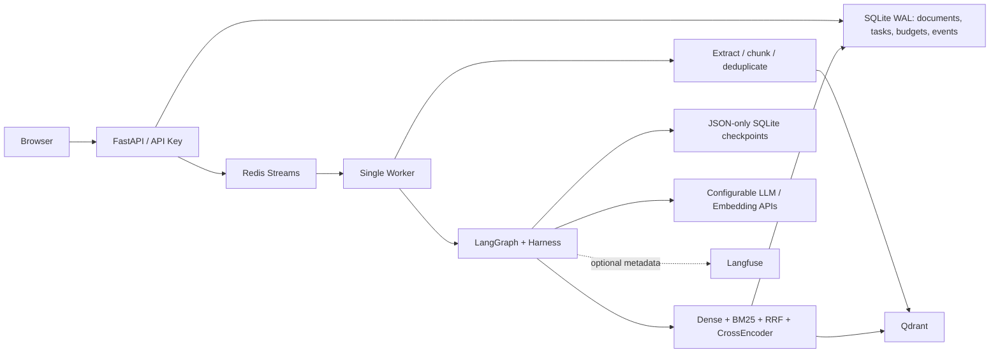

# Architecture and stage gates

In offline mode API and Worker run in one process, SQLite replaces queue notifications, and Qdrant Local
is owned by that process. Only the three model providers are explicit deterministic substitutes.

## Implementation gates

| Stage | Required evidence | Artifact |
|---|---|---|
| ETL / retrieval | Extraction, deduplication, source mapping, partial-index invisibility, RRF | reports/stage1.xml |
| Agent | Real graph loop, three tools, multiple turns, citation rejection | reports/stage2.xml |
| Harness | Bounded retries, budgets, idempotent reads, lease fencing, killed-process recovery | reports/stage3.xml |
| Service | PDF upload-to-report HTTP tests, UI, auth, SSRF, dependency health | reports/stage4.xml |
| Evaluation | Fixed qrels, metric reference values, raw timings, report generation | reports/pytest.xml |

Stages were implemented in that order; representative failures were fixed before advancing. Final
pytest includes the accumulated suite plus rebuild, provider-protocol and evaluation checks. Offline
passing results and skipped live integration are always reported separately.

## Source trust and data flow

Raw bytes are retained under hash-derived names. Normalized text defines document identity. Chunk IDs
combine document hash and normalized offsets. Vector upsert precedes SQLite publish; queries filter by
ready document IDs. BM25 refreshes against a consistent SQLite snapshot/version.

Agent evidence is accumulated by server-issued citation IDs. Comparison accepts only those IDs. Report
construction rereads source records and validates exact quotes. Source contents never grant capabilities.
The Harness owns retries, invocation budgets, cached outputs and execution deadlines. Graph checkpoints
alone do not guarantee external-operation idempotence.

See decisions.md for tradeoffs; debugging.md for observed failures and commit references.
