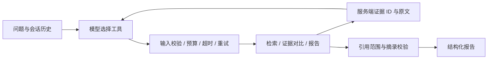

# 架构与数据流

KnowledgeOps 按单用户、单机部署设计。服务分为 API、Worker、Qdrant 和 Redis；SQLite 是任务与文档状态的最终依据，向量索引可以由原文重建。

## 导入与检索

文件先保存原始字节哈希，再提取和规范化文本。规范化内容决定文档 ID，相同内容通过来源别名关联。分块保留页码、章节和偏移，默认 800 字符、重叠 120 字符。
向量写入 Qdrant 成功后，SQLite 才将文档发布为 ready。查询只读取 ready 文档，避免导入失败后出现部分结果；稳定 chunk ID 使重试写入保持幂等。BM25 根据 SQLite 索引版本刷新，防止长驻 API 使用旧语料。

Dense 返回余弦相似度，BM25 保留原始词法分数，RRF 使用两路排名融合。CrossEncoder 仅对候选对打分；四类分数分别保存，不直接按原值相加。模型、维度、归一化、精度与分块策略写入索引指纹，配置不兼容时拒绝混用。

## Agent 与证据

`knowledge_search` 累积实际命中的证据；`compare_evidence` 只能引用这些证据；`build_report` 重新读取来源文本，核对引用 ID 和摘录。文档内容作为不可信输入，不能注册额外工具或扩大权限。
同一会话串行执行，保留最近四轮成功历史。重复命中的正文不重复发送，已有证据用 ID 回传；最多四次检索，避免缺少证据时持续搜索。最终引用通过只说明来源与摘录一致，语义正确性仍需独立判断。

## 执行与恢复

API 将任务与事件写入 SQLite，再通过 Redis Streams 通知 Worker。Redis 至少一次投递，Worker 通过条件更新取得任务租约，并定期扫描遗漏通知与过期租约。
LangGraph 检查点、预算账本和工具结果缓存分别持久化。恢复后沿用原预算和截止时间，重复读取调用可以复用结果。远端模型返回与本地结果落盘之间发生故障，仍可能再次计费，因此不承诺外部调用 exactly-once。

工具默认超时 30 秒，任务期限 180 秒，最多 12 步、8 次 LLM 请求、12 次工具尝试、20,000 Token；暂时性错误最多额外重试两次。客户端只能降低服务端限制。真实大文档验收使用单独的显式预算配置。
本地 CrossEncoder 在独立子进程中串行运行。超时后终止进程并拒绝迟到结果，避免只取消 coroutine 而让模型继续占用计算资源。

## 部署边界

离线模式将 API 与 Worker 合并，使用 Qdrant Local，不依赖 Redis。只有 LLM、Embedding、Reranker 使用测试替身；图、存储、PDF 提取、BM25 和 HTTP 路径仍运行实际组件。
四容器配置让 API 与 Worker 共享本地 SQLite 卷；不能将其改为 NFS 或直接扩展多个 Worker。规模扩展需要先替换共享事务数据库及内存 BM25 索引。

[设计取舍](decisions.md)记录方案背景和边界，[故障排查](debugging.md)记录实际失败与回归证据。
